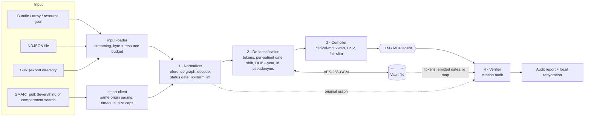

# Architecture

FHIRBridge turns a FHIR R4 export into a compact, de-identified, citation-anchored context for
an LLM, then checks what the model said about it. This document is for maintainers: how the
pieces fit, which invariants they protect, and why the main decisions were made.

## Pipeline

| Layer | Module | Input → output |
| :--- | :--- | :--- |
| Load | `src/normalizer/input-loader.ts`, `src/portability/smart-client.ts` | files / server → `InputEntry[]` + byte count |
| 1 Normalize | `src/normalizer/*` | entries → `NormalizedGraph` (index, status, members, medications, decoded documents, warnings) |
| 2 De-identify | `src/deid/*` | graph + vault → de-identified graph + `SafeHarborSummary` (counts only) |
| 3 Compile | `src/compiler/*` | de-identified graph → `CompiledContext` (content + token report) |
| 4 Verify | `src/verifier/*` | LLM text + original graph (+ vault) → `CitationAuditReport`, rehydrated text |
| Edges | `src/cli.ts`, `src/mcp/server.ts`, `src/index.ts` (SDK) | adapters only: no clinical logic |

Layers depend only on the contracts in `src/types/pipeline.ts` and `src/types/fhir.ts`, so each can
be tested and changed on its own. Shared utilities live in `src/shared/` (FHIR date arithmetic,
token estimate).

## Privacy invariants

These are enforced by code and covered by tests. Changes that weaken one need an explicit decision.

1. **Model-facing output comes only from the de-identified graph.** The compiler and every MCP
   tool read `deidGraph`; the MCP server state does not even hold the original graph.
2. **Fail closed.** The structured walker scrubs every string leaf except an allow-list of code,
   system, status and reference fields. A date-keyed value that does not parse is reduced to its
   year or dropped. Resources with no patient owner in a multi-patient graph get year-only dates.
3. **No offsets, no raw warnings.** `SafeHarborSummary` carries counts only. Normalizer warnings
   are rebuilt from fixed templates during de-identification.
4. **Dates of birth keep only the year**; ages over 89 become `90+`. Other dates are shifted by
   one secret offset per patient (HMAC of the canonical patient id), which preserves intervals.
5. **Rehydration is exact.** Only tokens the vault issued and dates the vault recorded as emitted
   are reversed; a vault with several patients requires an explicit patient.
6. **Nothing PHI-bearing reaches logs or errors.** The logger is deny-by-default
   (identifier-like strings, numbers, booleans). Third-party error messages (JSON.parse quotes
   input) are wrapped; causes print only under `--debug`.
7. **Secrets come from the environment.** The vault key is `FHIRBRIDGE_VAULT_PASSPHRASE`
   (scrypt, N=2^17) or `FHIRBRIDGE_VAULT_KEY`; a key file beside the vault needs `--allow-key-file`.

## Vault

- File: JSON envelope `{format, version, kdf, salt?, iv, tag, ciphertext}`; AES-256-GCM with a
  fresh 12-byte IV per save; v2 binds the header (format, version, kdf, salt) as AAD.
- Keys: one master key → HKDF-SHA256 → separate `enc` and `hmac` subkeys (the HMAC key drives
  date offsets and id pseudonyms).
- Writes: `<vault>.lock` created with `wx`, stale after 30 s; a concurrent modification raises
  `VAULT_CONFLICT` instead of overwriting another writer's tokens. Atomic tmp-file + rename.

## Errors and exit codes

`src/errors.ts` defines `FhirBridgeError` with a stable `code`. The CLI has one error boundary that
maps codes to sysexits-style exit codes:

| Exit | Codes |
| ---: | :--- |
| 0 | success |
| 1 | `VERIFY_FAILED` (critical citation issues — an expected outcome) |
| 64 | `USAGE` (unknown command, invalid option) |
| 65 | `INPUT_INVALID`, `INPUT_TOO_LARGE` |
| 66 | `INPUT_NOT_FOUND` |
| 69 | `PULL_FAILED` |
| 70 | `INTERNAL` |
| 74 | `VAULT_IO` |
| 75 | `VAULT_CONFLICT`, `PULL_TIMEOUT` |
| 77 | `VAULT_DECRYPT_FAILED`, `PULL_AUTH` |
| 78 | `CONFIG_INVALID`, `VAULT_KEY_MISSING` |

## Resource limits

| Limit | Default | Where |
| :--- | :--- | :--- |
| Input bytes (file or directory total) | 1024 MB (`FHIRBRIDGE_MAX_INPUT_MB`) | input-loader |
| Resources per input | 2,000,000 (`FHIRBRIDGE_MAX_RESOURCES`) | input-loader |
| Bundle nesting | 8 levels | input-loader |
| Decoded document text scrubbed | 200,000 chars (then `[TRUNCATED]`) | deid |
| `pull` request timeout / page size | 60 s / 50 MB | smart-client |
| `pull` pages | 200 per resource type (`--max-pages`) | smart-client |

NDJSON is streamed line by line. The token estimate is derived from the byte count, so the raw
text is never retained.

## Observability

- `src/logger.ts`: one line per event on stderr, `text` or `json` (`--log-format`,
  `FHIRBRIDGE_LOG_FORMAT`), levels via `FHIRBRIDGE_LOG_LEVEL`, `-v`, `-q`.
- Events: `pack.done`, `verify.done`, `command.failed`, `mcp.ready`, `mcp.tool` (tool name,
  outcome, duration — never arguments), `mcp.shutdown`.
- `fhirbridge doctor` checks Node, configuration, the vault key's shape (never its value), crypto
  primitives and the MCP SDK.

## Key decisions

| Decision | Why |
| :--- | :--- |
| Encrypted JSON vault, not SQLite | Keeps `npx fhirbridge` free of native modules |
| Date shift by default, DOB year-only | Keeps clinical intervals usable by the model; DOB carries the most re-identification risk. Documented as not strict Safe Harbor |
| Pseudonymize only ids that embed identifiers | Readable anchors (`obs-301`) for the common case; ids with digit runs or registered names are replaced |
| `completed` medication orders are history; completed fills of an active drug count as refills | Matches how clinicians read a medication list |
| Default-deny scrubbing of structured strings | New or vendor-specific fields are safe by default |
| Benchmarks only from `scripts/` | Every published number is reproducible |

## Performance

`scripts/scale-benchmark.mjs` generates N synthetic patients as a Bulk-export directory and
reports load and pack time, per-resource cost and peak heap. Name matching folds text per
character with an ASCII fast path and memoizes canonical names and folded keys. Each patient's
matcher includes every provider name (a provider can appear in any note, and overlapping
surnames must be detected as ambiguous), so very large multi-patient exports grow slightly
faster than linearly.
