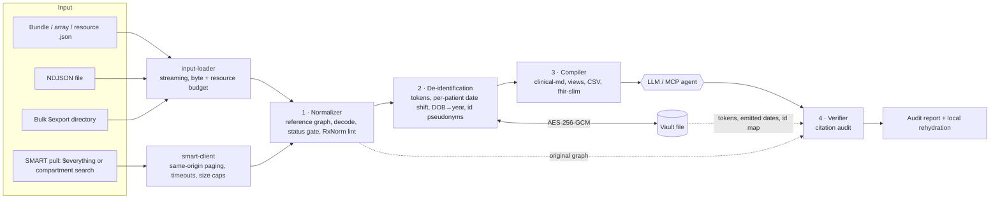

<h1 align="center">FHIRBridge</h1>

<p align="center">
  <b>Turn a 50k-token FHIR export into an 800-token, de-identified, citation-anchored clinical context, then verify what the LLM said about it.</b>
</p>

<p align="center">
  <a href="https://github.com/Digital-Healthcare-OpenSource/fhirbridge-context/actions/workflows/ci.yml"></a>
  
  = 22.12" src="https://img.shields.io/badge/node-%3E%3D22.12-339933.svg">
  
  
</p>

```bash
export FHIRBRIDGE_VAULT_PASSPHRASE='use-a-long-passphrase'
# De-identified by default. --free-text omit drops all free text: the recommended mode for real data.
npx fhirbridge pack patient-export.json --vault patient.vault.json --free-text omit > context.md
```

FHIRBridge is a zero-config **CLI, SDK and MCP server** that sits between messy EHR FHIR R4 exports and an LLM:

1. **Normalize**: resolves references (`Type/id`, `urn:uuid:`, `#contained`), decodes Base64 notes, strips XHTML narrative, repairs over-long ids and missing timestamps, and lints RxNorm codes.
2. **De-identify reversibly**: removes or tokenizes the 18 HIPAA identifier categories, reduces the date of birth to a year, and shifts every other date by a secret per-patient offset that keeps intervals intact. Token mappings live in an AES-256-GCM vault. This is **not** strict Safe Harbor; see [Privacy model and limits](#privacy-model-and-limits).
3. **Compile**: dense clinical Markdown (or SQL-on-FHIR-style tables) where every fact ends with a `[ResourceType/id]` anchor.
4. **Verify**: checks the model's answer against the record, catching invented ids, stopped drugs described as current, and wrong lab values. It then restores the real names and dates locally.

It runs fully offline, with no Docker, no JVM and no cloud API. The runtime dependencies are `commander`, `zod` and `@modelcontextprotocol/sdk`.

---

## Benchmark

Every number below comes from a script in [`scripts/`](scripts) run on the synthetic fixture in
[`tests/fixtures`](tests/fixtures). To reproduce: `npm run build && npm run bench`, and
`node --expose-gc scripts/scale-benchmark.mjs 10 100 1000`.

**One patient** ([`scripts/benchmark.mjs`](scripts/benchmark.mjs)):

| Metric | Value |
| :--- | :--- |
| Input | 195.9 KB, 95 resources (1 patient, 50 refills, 30 HbA1c results, Base64 notes, PDF) |
| Tokens before → after | **50,145 → 793 (−98.4%)** |
| Pack time (normalize + de-identify + compile, median of 15) | 25 ms |
| CLI cold start (`fhirbridge --version`, median of 5) | 144 ms |
| npm tarball | 268 KB |
| Identifiers tokenized / dates shifted | 171 / 190 |
| Planted PHI strings leaked into the context | **0 / 13** |
| Date-shift offset leaked into the context | **0** |
| Clinical terms preserved (`2/12 cores`, `Foley`, `Parkinson's`, `5/5`, drug names) | **6 / 6** |
| `entered-in-error` excluded / RxNorm code conflicts flagged | 1 / 1 |

**Bulk export** ([`scripts/scale-benchmark.mjs`](scripts/scale-benchmark.mjs), one NDJSON file per resource type):

| Patients | Resources | Input | Load | Pack | µs / resource | Peak heap |
| ---: | ---: | ---: | ---: | ---: | ---: | ---: |
| 10 | 950 | 1.4 MB | 27 ms | 0.26 s | 301 | 19 MB |
| 100 | 9,500 | 14.1 MB | 168 ms | 1.8 s | 210 | 135 MB |
| 1,000 | 95,000 | 141.4 MB | 1.6 s | 25.5 s | 285 | 705 MB |

Cost per resource stays roughly flat as the export grows. Token counts are estimates at 4 bytes
per token, applied the same way to input and output. Timings are from Node 24 on Windows x64 with
an otherwise idle CPU. Real exports vary, so run the scripts on your own data.

## What you get

```markdown
# CLINICAL SUMMARY CONTEXT (FHIRBridge v0.1.0 | De-identified: YES)

## 1. Patient Demographics [Patient/pat-1]
- Name: [PATIENT_1] | Gender: female | Age: 64 | Birth year: 1962 | ZIP: 021XX | MRN: [MRN_1] [Patient/pat-1]

## 4. Active Medications (Deduplicated by RxNorm)
- Metformin 500 MG Oral Tablet [RxNorm: 861007] — 1 tablet twice daily with meals (Authored: 2024-08-16, Status: active, Refills consolidated: 50) [MedicationRequest/medreq-104]

## 5. Discontinued / Stopped Medications (DO NOT TREAT AS ACTIVE)
- Lisinopril 10 MG Oral Tablet [RxNorm: 314076] — Status: stopped (2023-10-06, Reason: Dry cough) [MedicationRequest/medreq-088]

## 6. Longitudinal Labs & Vitals (Grouped by LOINC)
| Metric (LOINC) | Latest Value | Date | Reference Range | Historical Trend (Chronological) | Source Anchor |
| HbA1c (4548-4) | 7.8 % (HIGH) | 2024-08-14 | 4 - 5.6 % | 7.9% (2023-02-08) -> … -> 7.8% (2024-08-14) | [Observation/obs-301] |

## 7. Clinical Notes & Decoded DocumentReferences
- [2024-08-14] Progress Note by [PROVIDER_1]: Pt [PATIENT_1] ([MRN_1]) … Breast core biopsy: 2/12 cores positive. Foley catheter removed. Family history of Parkinson's disease. … [DocumentReference/doc-12]

## 8. Clinical Data Integrity Warnings (Auto-Detected by FHIRBridge)
- EXCLUDED: 1 resource(s) with status='entered-in-error' ([MedicationRequest/medreq-err-99]: Aspirin 81 MG Oral Tablet)
- CODE WARNING: [MedicationRequest/medreq-bad-1] display "Tiotropium 18 MCG Inhalation Capsule" conflicts with RxCUI 1116634 ("ticagrelor").
```

Ask the model to cite the anchors. Then check its answer:

```bash
$ fhirbridge verify answer.txt --bundle patient-export.json --vault patient.vault.json
Citations checked: 3; issues: 2
  [CRITICAL] CRITICAL_STATUS_CONTRADICTION MedicationRequest/medreq-088: … historical in the source record but the sentence presents it as current.
  [CRITICAL] HALLUCINATED_RESOURCE_ID Observation/obs-k-1: … does not exist in the source record.
✖ Critical issues found.          # exit code 1, so it can gate a pipeline

$ fhirbridge rehydrate answer.txt --vault patient.vault.json
Maria Elena Gonzalez's HbA1c improved to 7.8% on 2025-08-10 [Observation/obs-301]. …
```

## Why

Feeding raw FHIR to an LLM goes wrong in predictable ways:

- **Bloat.** Most of an export is structural JSON, repeated XHTML narrative and Base64 attachments. Long records overflow context windows or get silently truncated by local runtimes.
- **Broken graphs.** Medication names hide behind `medicationReference`, labs hang off panels, and bulk exports carry ids over FHIR's 64-character limit or no `meta.lastUpdated`. Some datasets carry RxNorm codes that do not match their display text.
- **De-identification that breaks the timeline.** Shifting each resource's dates independently destroys the intervals clinicians reason about, such as days since admission or time between labs. FHIRBridge derives one secret offset per patient (HMAC of the patient id) and applies it to every date in that patient's graph, including `contained`, extensions and free text. Time of day is preserved, so a 41 h 45 min gap stays 41 h 45 min. The offset itself is never written to any output.
- **Naive scrubbers damage the medicine.** Eponyms (`Foley`, `Swan-Ganz`, `Parkinson's`, `Hodgkin`) get redacted as names, and clinical fractions (`2/12 cores`, `4/5` strength, `PEEP 10/5`) get rewritten as dates. FHIRBridge masks those patterns before it detects identifiers.
- **Status hallucination.** Summaries merge `stopped` and `entered-in-error` orders into the active medication list. FHIRBridge gates status at compile time and audits it again in the answer.

## Install

```bash
npx fhirbridge --help              # once published to npm
# from source:
git clone https://github.com/Digital-Healthcare-OpenSource/fhirbridge-context && cd fhirbridge-context
npm ci && npm run build && node dist/cli.js --help
```

Requires Node.js ≥ 22.12.

## CLI

| Command | What it does |
| :--- | :--- |
| `fhirbridge pack <input> [--no-deid] [--free-text scrub\|omit] [--vault <file>] [-f clinical-md\|view-json\|csv\|fhir-slim] [--patient Patient/id] [-o out]` | Layers 1→3. **De-identifies by default.** Context goes to stdout and statistics to stderr. Without `--vault` an in-memory vault is used and rehydration is impossible. `--patient` accepts the original id even when the output pseudonymized it, and exits 65 when no such patient exists. |
| `fhirbridge verify <answer.txt> --bundle <input> [--vault <file>] [--rehydrate] [--patient Patient/id] [--json]` | Layer 4 citation audit. With `--vault`, pseudonymized ids the model cites are mapped back to the bundle's ids. Exits 1 on critical findings. |
| `fhirbridge rehydrate <answer.txt> --vault <file> [--patient Patient/id]` | Restores tokens and reverses the dates the tool shifted. A vault with several patients requires `--patient`. |
| `fhirbridge audit <input> [--json]` | Resource counts, token savings, PHI found, `entered-in-error` records and code conflicts. Operator-only: its warnings can contain raw values. |
| `fhirbridge pull --iss <fhir-base> --patient <id> [--no-deid] [--free-text scrub\|omit] [--vault <file>] [--max-pages <1-10000>] [--allow-private-network]` | Pulls `Patient/$everything` (falling back to a compartment search) from any FHIR R4 server, then packs. De-identifies by default. |
| `fhirbridge mcp --bundle <input> [--vault <file>] [--free-text scrub\|omit] [--allow-rehydrate]` | Starts the MCP server on stdio. |
| `fhirbridge doctor` | Checks the Node version, configuration and vault key setup (prints no secret values). |

`--no-deid` (on `pack` and `pull`) switches de-identification off, prints a warning on stderr before anything is written, and produces output with real names, identifiers and dates. Never send that output to an external LLM.

`--free-text omit` is **structured-only mode**: every free-text field and every decoded document is dropped, so no narrative can carry an identifier past the scrubber. It is the recommended mode for real patient data (see [Privacy model and limits](#privacy-model-and-limits)). The default, `scrub`, keeps notes and redacts them on a best-effort basis.

`pull` refuses an `--iss` whose host is an IP literal in a private, loopback, link-local or cloud-metadata range (`127.0.0.0/8`, `10.0.0.0/8`, `172.16.0.0/12`, `192.168.0.0/16`, `169.254.0.0/16`, `::1`, `fc00::/7`, `fe80::/10`, and IPv4-mapped forms), so a crafted URL cannot probe your internal network. `localhost`, `127.0.0.1` and `[::1]` stay allowed (plain `http:` is accepted for them, for local development). Pass `--allow-private-network` when your FHIR server really lives on an internal address. Only literals are checked: a host name is not resolved, so use egress controls if the name can point inside your network.

`<input>` can be a Bundle, a JSON array of resources, a single resource, an `.ndjson` file, or a Bulk `$export` directory of `.ndjson` files.

`pull` falls back to a compartment search when `$everything` is unsupported. In that search only HTTP 400/404/405 for a resource type are skipped, and each skipped type is reported as a warning; 401/403/408/429/5xx abort the pull instead of returning a partial record. Requests time out after 60 s, a single page is capped at 50 MB, and `--max-pages` applies per resource type.

The input limits apply to a `pull` too: total bytes and resources are counted across **all** pages (raw pages are not kept in memory) and the pull stops with exit 65 when a limit is exceeded. `--max-pages` must be an integer from 1 to 10000. Error messages never contain the server URL.

### Configuration reference

Secrets come from the environment only, never from argv. Invalid values fail fast with exit 78 and name the variable (never its value).

| Variable | Default | Purpose |
| :--- | :--- | :--- |
| `FHIRBRIDGE_MAX_INPUT_MB` | `1024` | Maximum total input size in MB (1-65536), also applied across all pages of a `pull`. A single NDJSON line is capped at 64 MB. |
| `FHIRBRIDGE_MAX_RESOURCES` | `2000000` | Maximum number of FHIR resources accepted from one input (1-50000000). |
| `FHIRBRIDGE_LOG_FORMAT` | `text` | Diagnostics format on stderr: `text` or `json` (same as `--log-format`). |
| `FHIRBRIDGE_LOG_LEVEL` | `info` | `silent`, `error`, `warn`, `info` or `debug` (`-q` and `-v` override). |
| `FHIRBRIDGE_VAULT_PASSPHRASE` | none | Derives the vault key (scrypt); at least 12 characters. |
| `FHIRBRIDGE_VAULT_KEY` | none | 64 hex chars; used instead of a passphrase. |
| `FHIRBRIDGE_TOKEN` | none | Bearer token for `pull` (preferred over `--token`, which is visible in `ps`). |

A vault key is required: set `FHIRBRIDGE_VAULT_PASSPHRASE` or `FHIRBRIDGE_VAULT_KEY`. FHIRBridge does not silently create a key file. If you accept the weaker setup where the key sits beside the data, pass `--allow-key-file` explicitly.

### Exit codes

| Exit | Meaning | Codes |
| ---: | :--- | :--- |
| 0 | Success | |
| 1 | Verification found critical clinical issues (an expected outcome, not a crash) | `VERIFY_FAILED` |
| 64 | Usage error: unknown command, invalid option, vault with several patients and no `--patient` | `USAGE` |
| 65 | Input is not usable: invalid JSON, too deeply nested, over a size limit, unknown `--patient` | `INPUT_INVALID`, `INPUT_TOO_LARGE` |
| 66 | Input path does not exist | `INPUT_NOT_FOUND` |
| 69 | Pull failed: server error, refused address, network failure | `PULL_FAILED` |
| 70 | Internal error (re-run with `--debug`) | `INTERNAL` |
| 74 | Vault file I/O error | `VAULT_IO` |
| 75 | Temporary failure: vault changed by another process, or the pull timed out | `VAULT_CONFLICT`, `PULL_TIMEOUT` |
| 77 | Permission: wrong vault key, or the FHIR server refused the token (401/403) | `VAULT_DECRYPT_FAILED`, `PULL_AUTH` |
| 78 | Configuration: invalid `FHIRBRIDGE_*` value or no vault key | `CONFIG_INVALID`, `VAULT_KEY_MISSING` |

## MCP: Claude Desktop, Cursor, OpenCode

```json
{
  "mcpServers": {
    "fhirbridge": {
      "command": "npx",
      "args": ["-y", "fhirbridge", "mcp", "--bundle", "/path/to/patient-export.json", "--vault", "/path/to/patient.vault.json"],
      "env": { "FHIRBRIDGE_VAULT_PASSPHRASE": "use-a-long-passphrase" }
    }
  }
}
```

| Tool | Returns |
| :--- | :--- |
| `get_patient_clinical_summary` | The de-identified `clinical-md` context (or `view-json` / `csv`) |
| `query_patient_resources` | De-identified resources filtered by type, code, shifted date range and status. `entered-in-error` records are never returned. |
| `verify_and_rehydrate_clinical_draft` | A citation audit of the agent's draft |
| `audit_bundle_integrity` | EHR data-quality warnings (code, resource key, sanitized message), de-identification counts and token statistics |

Tool results are model input, so the MCP server **never returns real PHI unless started with `--allow-rehydrate`**. Every tool reads the de-identified graph only. Rehydrate on your side with `fhirbridge rehydrate`; use `--allow-rehydrate` only when the model runs locally. Even then, only tokens the server itself has shown to the model are restored.

## SDK

```ts
import { packFile, verifyResponse, SafeHarborVault, StreamRehydrator } from 'fhirbridge';

const vault = await SafeHarborVault.open('patient.vault.json', { passphrase: process.env.VAULT_PASS });
const { context, graph } = await packFile('patient-export.json', { deid: true, vault });
await vault.save('patient.vault.json');

const answer = await llm(context.content);                  // your model call
// The vault maps pseudonymized ids back to `graph`; pass { patientKey } if it holds several patients.
const { report, rehydrated } = verifyResponse(answer, graph, vault);
if (!report.ok) throw new Error(report.issues.map((i) => i.code).join(', '));

// Streaming: tokens and dates split across SSE chunks are held back until complete.
const stream = new StreamRehydrator(vault);
for await (const chunk of llmStream) process.stdout.write(stream.push(chunk));
process.stdout.write(stream.end());
```

Each layer is also published on its own: `fhirbridge/normalizer`, `fhirbridge/deid`, `fhirbridge/compiler`, `fhirbridge/verifier`.

## Architecture



[`ARCHITECTURE.md`](ARCHITECTURE.md) covers the invariants, the vault format and the resource limits.

## Privacy model and limits

Read this before using it with real patient data.

- **This is not strict HIPAA Safe Harbor.** Safe Harbor requires removing all elements of dates except the year. FHIRBridge removes or tokenizes the 18 identifier categories and reduces the date of birth to the year (ages over 89 become `90+`), but by default it **shifts** all other dates by a secret per-patient offset instead of removing them. Date shifting is a technique used under Expert Determination, not under Safe Harbor, and it keeps day-level information that Safe Harbor would remove. Treat the output as de-identified for LLM use under your own risk assessment, not as a Safe Harbor determination, and have your privacy officer or an expert validate it before data leaves your control.
- **De-identification is the default and can be turned off.** `pack` and `pull` de-identify unless you pass `--no-deid`, which prints a warning and outputs real identifiers and dates.
- **For real patient data, use `--free-text omit` ("structured-only").** It removes all free text and decoded documents, so the output consists of coded and structured fields only. Free-text scrubbing (`--free-text scrub`, the default) is **best-effort and not Safe Harbor-complete**. Known gaps: names with no cue word that are not registered from a structured field, identifiers that carry no label (a bare number in a sentence), and unusual date formats (for example `5th of March 1930`, `03.05.30`, dates spelled in another language or split across lines). It also cannot recognise facts that identify a person without being an identifier. Use `scrub` only on data you have validated on a sample.
- **Free-text detection is heuristic.** Structured fields are handled for all 18 identifier categories, and biometrics and photos are handled by removing attachment payloads. In free text, names are found through dictionaries, names registered from structured fields, and cue words (`Pt`, `Dr.`, `signed by`, relationship words such as `mother` or `husband`, and CJK, Vietnamese and Korean honorific cues). A name with no cue that is not registered from a structured field can be missed. Validate the output on a sample of your own notes before relying on it.
- **The vault contains PHI** (encrypted). Anyone holding the vault and its key can reverse the tokens. The key must come from the environment (`FHIRBRIDGE_VAULT_PASSPHRASE` or `FHIRBRIDGE_VAULT_KEY`); a key file next to the vault is used only with `--allow-key-file`. Keep the key off the machine that talks to the LLM.
- **Rehydration reverses only dates the tool emitted.** The vault records the exact shifted dates it produced for each patient. Any other date, such as a guideline year or a date the model computed, is left exactly as written. A vault that holds several patients requires you to name one (`--patient Patient/id`).
- **The MCP server never returns real PHI unless started with `--allow-rehydrate`**, and then only for tokens it has already shown to the model. Use that flag only with models that run locally.
- **Resource ids that embed identifiers are pseudonymized.** Ids longer than 64 characters are shortened. Pass the vault to `verify` / `verifyResponse` so the ids a model cites map back to your bundle.
- **The RxNorm dictionary is small.** It covers common outpatient drugs and known bad codes. It is not a terminology server.
- **This is not a medical device.** The verifier reduces some failure modes; it does not make model output clinically safe.

## Production runbook

### Docker with read-only mounts

The image is distroless, runs as `nonroot`, and has no shell. Mount the input read-only and give the vault its own writable volume; nothing else on the container needs to be writable.

```bash
docker run --rm --read-only --cap-drop ALL --security-opt no-new-privileges \
  -e FHIRBRIDGE_VAULT_PASSPHRASE \
  -v "$PWD/exports:/data/in:ro" \
  -v fhirbridge-vaults:/data/vault \
  ghcr.io/digital-healthcare-opensource/fhirbridge \
  pack /data/in/patient.json --vault /data/vault/patient.vault.json --free-text omit > context.md
```

Pass the key with `-e NAME` (inherits from your shell) rather than `-e NAME=value`, so it does not appear in `docker inspect` or shell history. Keep the vault volume on a different host or account than the one that sends context to the LLM.

### Key management and rotation

- Generate a long random passphrase (or a 64-hex `FHIRBRIDGE_VAULT_KEY`) and keep it in a secret manager; inject it as an environment variable at run time. Never put it in argv, an image, or a repository.
- A vault is encrypted with one key and the key cannot be changed in place. **To rotate, re-pack into a new vault:** export the data again, run `pack` with the new key and a new `--vault` path, switch consumers to the new vault, then securely delete the old vault and retire the old key. Tokens and date offsets in the new vault differ from the old one, so answers produced from the old context can be rehydrated only with the old vault. Keep it until those answers are no longer needed.
- Treat a lost key as a lost vault: there is no recovery, and rehydration becomes impossible (the de-identified context stays valid).
- If a key may have been exposed, rotate it and treat the old vault as compromised.

### Pre-flight and monitoring

- `fhirbridge doctor` checks the Node version, the `FHIRBRIDGE_*` configuration and the vault key setup without printing any secret. Run it as a deployment smoke test; it exits 78 on a problem.
- Use `--log-format json` (or `FHIRBRIDGE_LOG_FORMAT=json`) to get one JSON event per line on stderr, ready for a log shipper such as Fluent Bit, Vector or the Datadog agent. Events carry counts, codes and durations only, never patient values. Set `FHIRBRIDGE_LOG_LEVEL=warn` in steady state. stdout carries only the context, so redirect or pipe it separately from stderr.

### Exit codes in pipelines

```bash
fhirbridge pack export.json --vault v.vault.json --free-text omit -o context.md
case $? in
  0)  ;;                                              # success
  65) echo "bad or oversized input"; exit 1 ;;        # fix the export, do not retry
  69|75) sleep 30; retry ;;                           # transient: pull failed, timeout, vault busy
  77|78) echo "credentials or config"; exit 1 ;;      # page the operator, do not retry
  *)  echo "unexpected"; exit 1 ;;
esac
```

`fhirbridge verify` exits 1 when the model contradicts the record: treat that as a gate (block the answer), not as an error.

### Troubleshooting by exit code

| Exit | Likely cause | What to do |
| ---: | :--- | :--- |
| 1 | The answer cites ids that do not exist, or calls a stopped drug current | Read the issue list on stderr; regenerate the answer. |
| 64 | Misspelled option, invalid `--format`, `--free-text` or `--max-pages`; `rehydrate` on a vault with several patients | Check `--help`; add `--patient Patient/id`. |
| 65 | Truncated or non-FHIR JSON, nesting over 256 levels, a single NDJSON line over 64 MB, input over the limits, or `--patient` that is not in the input | Validate the export; raise `FHIRBRIDGE_MAX_INPUT_MB` / `FHIRBRIDGE_MAX_RESOURCES` or split by patient. |
| 66 | Wrong path, or the container mount is missing | Check the `-v` mapping. |
| 69 | HTTP error from the server, unreachable host, or an `--iss` on a private address | Check the URL; add `--allow-private-network` for an internal server. |
| 70 | Bug | Re-run with `--debug` (its output may contain input data; do not share it) and open an issue with a synthetic reproduction. |
| 74 | Vault path not writable, disk full | Fix permissions or space on the vault volume. |
| 75 | Another process changed the vault, or the server timed out | Re-run; serialize runs that share a vault. |
| 77 | Wrong vault passphrase, or the server rejected the token | Check the secret and the token scopes. |
| 78 | Invalid `FHIRBRIDGE_*` value, or no vault key | Run `fhirbridge doctor`. |

## Development

```bash
npm ci
npm test          # 200+ tests: one suite per layer, end-to-end, MCP (in-memory client), SMART client
npm run lint      # tsc --noEmit (strict)
npm run build
npm run fixtures  # regenerate the synthetic fixture
npm run bench
```

The six acceptance tests in [`tests/fhirbridge.test.ts`](tests/fhirbridge.test.ts) cover token compression and reference resolution, patient-scoped date shift and reversal, eponym and fraction protection, the status gate and code linter, citation hallucination and contradiction detection, and streaming rehydration across split chunks.

## License

[MIT](LICENSE). All patient data in this repository is synthetic.
